# Incident Management Lab

## Sobre o projeto

Este projeto apresenta uma simulação prática de gestão de incidentes, inspirada nas boas práticas ITIL 4.

O objetivo foi acompanhar um incidente desde o registo inicial até ao encerramento, incluindo classificação de prioridade, comunicação, investigação técnica, análise de logs, testes de autorização e acompanhamento de SLA.

Para complementar a documentação do incidente, desenvolvi e executei um laboratório local em Python, permitindo reproduzir uma falha simulada, gerar logs e validar uma alteração de permissões.

**Natureza do projeto:** Portfólio técnico e ambiente de aprendizagem com dados fictícios.

## Tecnologias e ferramentas

- Python 3
- Visual Studio Code
- Biblioteca logging do Python
- GitHub — versionamento e documentação
- Notion — gestão e acompanhamento de tickets
- Google Drive — organização de evidências
- Conceitos de ITIL 4 — Incident Management

---

## 1. Cenário do incidente

**Ticket:** INC-002 — Falha de acesso à aplicação

**Empresa:** Comércio Digital PT (fictícia)

**Utilizadora:** Ana Martins (fictícia)

**Departamento:** Financeiro

**Aplicação:** Gestão de Encomendas

**Problema reportado:** Erro HTTP 500 durante o acesso.

A utilizadora reportou dificuldades de acesso à aplicação, enquanto outros colaboradores conseguiam utilizá-la normalmente.

A falha comprometia a preparação de um relatório financeiro com prazo definido.

### Registo inicial

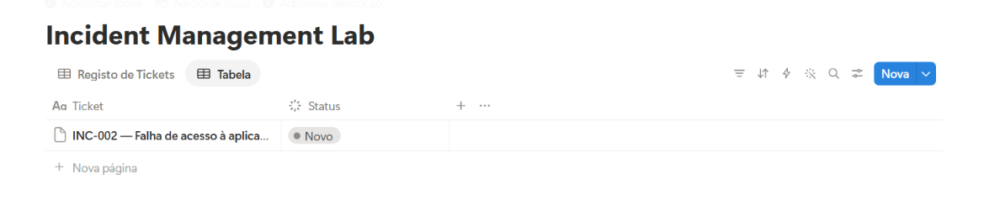

---

## 2. Classificação e gestão do incidente

Foi realizada uma avaliação inicial do impacto e da urgência, considerando o número de utilizadores afetados e as consequências para a atividade profissional.

| Critério | Classificação |
|---|---|
| Impacto | Baixo |
| Urgência | Média |
| Prioridade | P3 — Média |

A classificação foi definida com base numa matriz fictícia de prioridades para o laboratório.

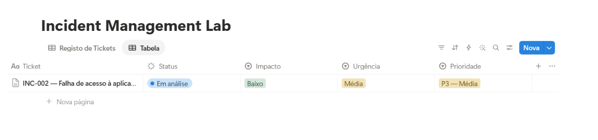

### Comunicação com a utilizadora

Foi documentado um contacto corporativo simulado para recolher informações sobre o início da falha, os testes realizados e as consequências para o departamento financeiro.

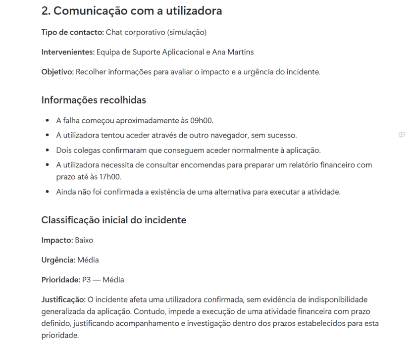

---

## 3. Investigação técnica

A investigação inicial considerou diferentes hipóteses para o erro HTTP 500.

Foi identificado, no cenário fictício, um incidente semelhante relacionado com permissões, bem como uma alteração recente do perfil da utilizadora.

Estas informações foram utilizadas para formular uma hipótese de falha no processo de autorização.

### Laboratório Python

Para estudar o comportamento, desenvolvi uma aplicação local em Python com três versões de teste:

| Ficheiro | Finalidade |
|---|---|
| [app_falha.py](laboratorio-python/app_falha.py) | Reproduzir a falha simulada de permissões |
| [app_corrigida.py](laboratorio-python/app_corrigida.py) | Testar a alteração da configuração |
| [app_validacao.py](laboratorio-python/app_validacao.py) | Validar acessos autorizados e negados |

A documentação e as instruções de execução estão disponíveis no [README técnico do laboratório Python](laboratorio-python/README.md).

---

## 4. Análise dos logs

Na primeira execução, o programa foi configurado sem a permissão `orders.read`.

Os logs gerados indicaram:

- Autenticação simulada bem-sucedida.
- Falha na validação de permissões.
- Ausência da permissão `orders.read`.
- Registo de erro HTTP 500 simulado.

### Evidência da falha

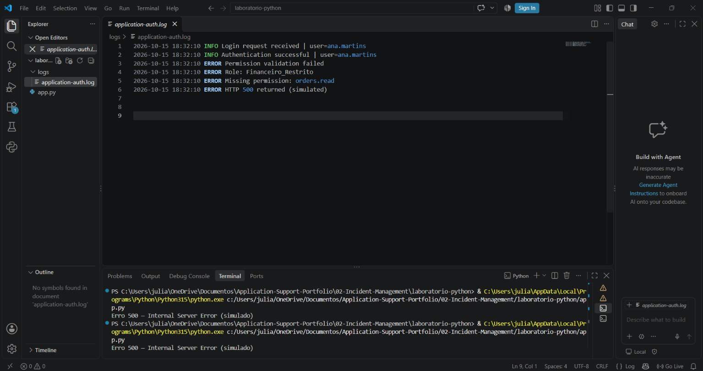

O registo técnico está disponível em [exemplo-auth.log](laboratorio-python/logs/exemplo-auth.log).

A investigação foi também documentada no Notion.

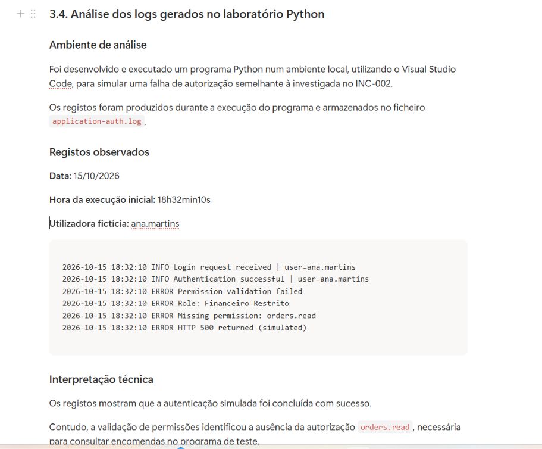

---

## 5. Teste de correção

Foi realizada uma alteração controlada na configuração do laboratório.

**Configuração inicial:**

```python
permissoes = ["reports.read"]
```

**Configuração corrigida:**

```python
permissoes = ["reports.read", "orders.read"]
```

Após a alteração, o programa apresentou a mensagem:

```text
Acesso autorizado
```

### Evidência do teste

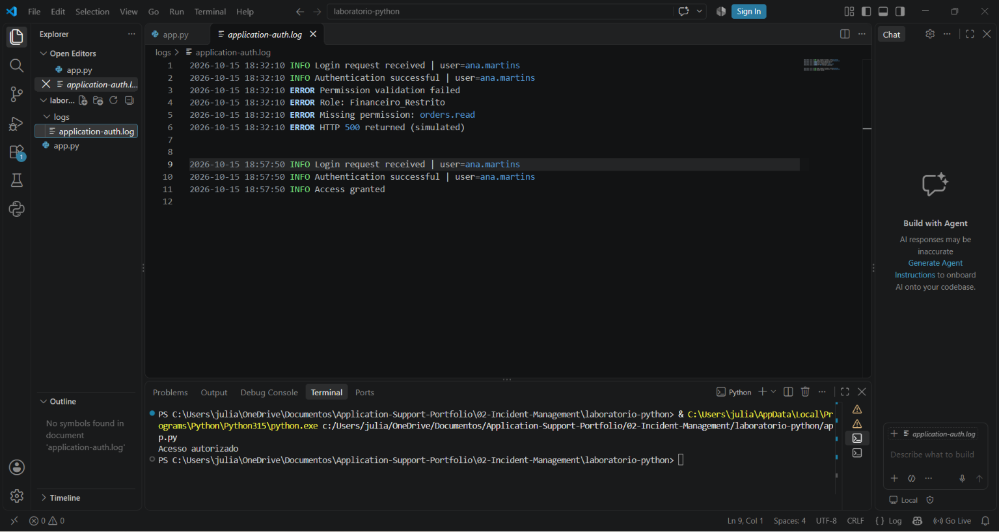

A comparação demonstrou que a ausência da permissão era responsável pela falha programada no ambiente de laboratório.

A conclusão foi documentada no Notion.

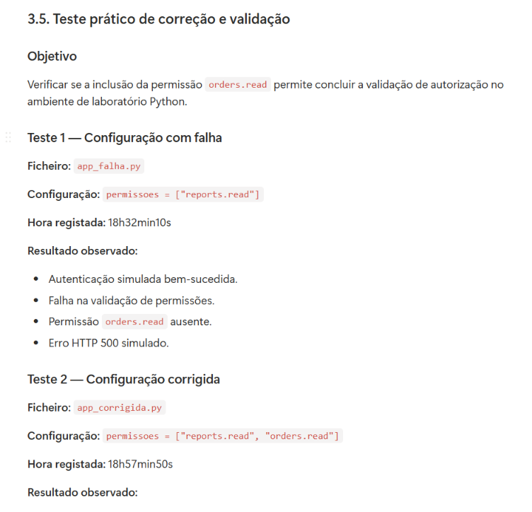

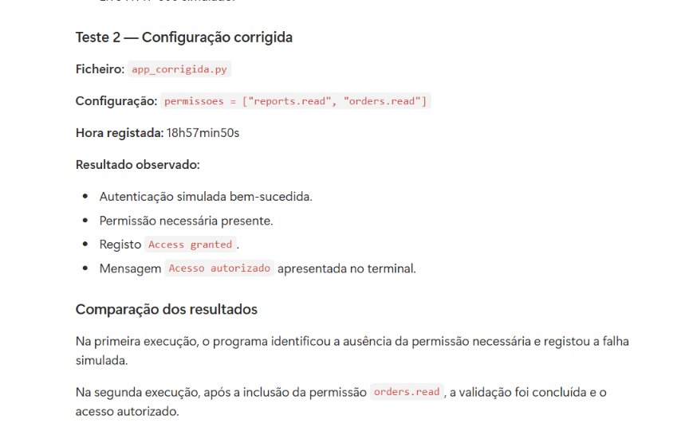

---

## 6. Validação do controlo de acesso

Foi desenvolvido um teste adicional para verificar o comportamento da aplicação com dois utilizadores fictícios.

| Utilizador | Permissão orders.read | Resultado |
|---|---|---|
| Ana Martins | Presente | Acesso autorizado |
| Bruno Costa | Ausente | Acesso negado |

O teste demonstrou que a lógica implementada permitia o acesso apenas quando a permissão necessária estava presente.

O programa também registou uma indicação simulada de HTTP 403 para representar a negação de acesso por falta de autorização.

### Evidência da validação

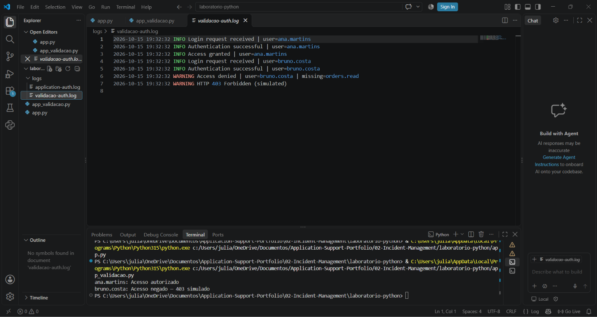

Os registos estão disponíveis em [validacao-auth.log](laboratorio-python/logs/validacao-auth.log).

---

## 7. Resolução do incidente

No laboratório, a inclusão da permissão `orders.read` permitiu concluir com sucesso a validação de autorização.

Foi realizada uma verificação adicional com utilizadores fictícios, demonstrando comportamentos diferentes para contas com e sem a permissão necessária.

O cenário incluiu uma confirmação fictícia da utilizadora e a documentação da conclusão do atendimento.

O incidente foi considerado resolvido no âmbito da simulação, sem escalonamento para outra equipa.

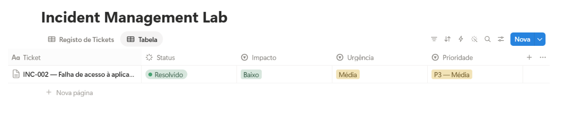

---

## 8. Acompanhamento do SLA

Foi definida uma política fictícia de SLA para o incidente de prioridade P3.

| Indicador | Valor |
|---|---|
| Abertura do ticket | 15/10/2026 — 09h15 |
| Primeira resposta | 15/10/2026 — 09h30 |
| Resolução | 15/10/2026 — 15h30 |
| Tempo de primeira resposta | 15 minutos |
| Tempo decorrido até à resolução | 6h15 |
| Limite de primeira resposta | 2 horas |
| Limite de resolução | 16 horas úteis |

**Resultado:** Ambos os indicadores ficaram dentro dos limites estabelecidos na simulação, considerando que o intervalo decorreu integralmente dentro do horário de serviço fictício.

Os horários de atendimento são dados criados para o cenário e não correspondem aos horários reais de execução do laboratório Python.

### Evidências do SLA

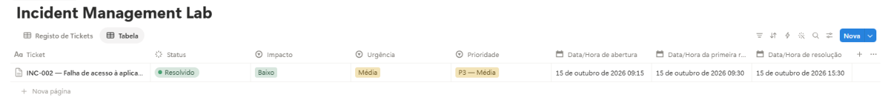

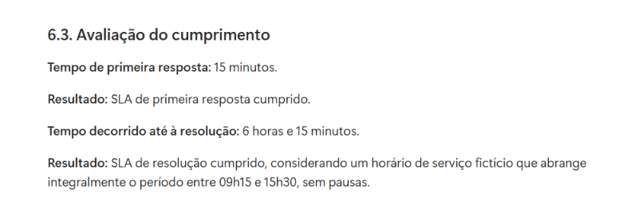

---

## 9. Encerramento

Após a documentação da investigação, dos testes, da resolução e dos indicadores de SLA, o ticket foi encerrado no ambiente fictício de gestão de incidentes.

**Estado final:** Encerrado — simulação.

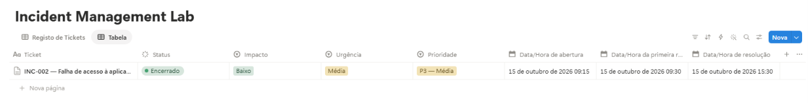

---

## 10. Competências demonstradas

Este projeto permitiu praticar:

- Registo e classificação de incidentes.
- Gestão do ciclo de vida de tickets.
- Avaliação de impacto, urgência e prioridade.
- Comunicação com utilizadores.
- Investigação e troubleshooting aplicacional.
- Formulação e validação de hipóteses.
- Desenvolvimento e execução de scripts Python.
- Geração e interpretação de logs.
- Identificação de falhas de autorização.
- Validação de controlo de acesso.
- Documentação de resoluções.
- Acompanhamento de SLA.
- Versionamento de código e organização de evidências.

## 11. Limitações e âmbito da simulação

O cenário empresarial, os utilizadores, as comunicações e os indicadores de atendimento foram criados para fins de aprendizagem.

Os logs técnicos foram efetivamente gerados durante a execução dos programas Python em ambiente local.

Contudo, a autenticação e as mensagens HTTP 500 e 403 são simuladas pelo código. O laboratório não implementa um servidor HTTP real nem está ligado a uma aplicação empresarial.

A correção e os testes demonstram o comportamento da aplicação desenvolvida para o exercício, não uma resolução comprovada num sistema de produção.

---

## Documentação complementar

- [Laboratório Python — documentação técnica](laboratorio-python/README.md)
- [Código da falha](laboratorio-python/app_falha.py)
- [Código da correção](laboratorio-python/app_corrigida.py)
- [Código da validação](laboratorio-python/app_validacao.py)
- [Logs da investigação](laboratorio-python/logs/exemplo-auth.log)
- [Logs de validação](laboratorio-python/logs/validacao-auth.log)

**Projeto desenvolvido para fins de portfólio profissional**
